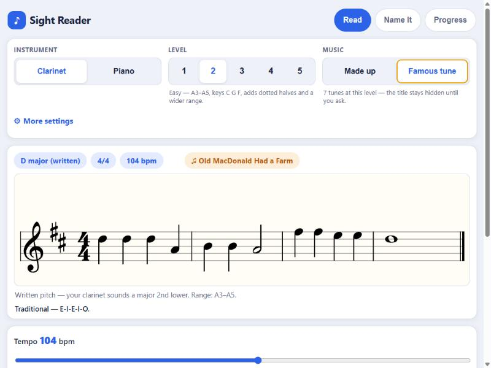

# Sight Reader

A sight-reading trainer for clarinet, viola and piano. It makes up short pieces of music,
counts you in, clicks a metronome while you play, and then plays the music back so
you can check yourself. Switch on listening and it goes further: it hears what you
play through the microphone and marks each note green or red as it goes by. There is
also a "Name It" drill for reading notes quickly, and a progress page that remembers
how practice is going.

Plain HTML, CSS and JavaScript — no build step, no install, no account, no network
calls. Everything it saves stays in the browser on that device, and what the
microphone hears is analysed and thrown away, never recorded or sent anywhere.



## Running it

**On this computer** — double-click `index.html`. That is all.

**On a tablet on the same wifi** — serve the folder from the computer:

```powershell
powershell -ExecutionPolicy Bypass -File .\serve.ps1 -AllowLan
```

It prints an address like `http://192.168.1.20:8787` — open that in the tablet's
browser. `-AllowLan` needs an elevated PowerShell window the first time; without it
the server is reachable only as `http://localhost:8787` on this machine.

On an iPad, Safari's **Share → Add to Home Screen** gives it an icon and a full
screen. Tap something on the page once before expecting sound — browsers only allow
audio after a tap.

**If you want the tablet to listen** (see [Listening while he plays](#listening-while-he-plays)),
plain `http://` is not enough: browsers only hand out the microphone on a secure
origin. `localhost` counts as secure, so listening works on this computer with no
setup at all, but `http://192.168.1.20:8787` on the tablet never even gets a
permission prompt.

The easy answer is the hosted copy at
**<https://jackypig.github.io/sight-reading/>** — it is https, so the tablet can use
the microphone there, the computer does not have to be switched on, and
**Add to Home Screen** works on it just the same.

To do it from this computer instead — offline, or to try changes before they are
pushed — serve it over https from an elevated PowerShell window:

```powershell
powershell -ExecutionPolicy Bypass -File .\serve.ps1 -Https -AllowLan
```

That makes a self-signed certificate the first time (three years, reused after
that), binds it to the port, and prints an `https://192.168.1.20:8787` address. The
tablet will warn about the certificate once — Safari: **Show Details → visit this
website**; Chrome: **Advanced → Proceed** — and after that the page counts as secure
and can ask for the microphone. The script also drops a `sight-reader-dev.cer` next
to itself: installing and trusting that on the tablet stops the warning for good,
but it is entirely optional.

To undo the port binding later: `netsh http delete sslcert ipport=0.0.0.0:8787`.

If none of that appeals, the simple answer is to do the listening practice on the
computer and leave the tablet for everything else — the rest of the app works the
same over plain http.

## The three screens

### Read

Generates a few bars of music and shows them in real notation.

- **Count in & play along** — one bar of clicks, then the metronome keeps time while
  he plays. A blue highlight slides along so he can see where the beat is.
- **Listen while I play** — optional: the app hears what he plays and marks every
  note. See below.
- **Hear it** — plays the same music back (clarinet or piano sound) to check against.
- **New music** — a fresh exercise.
- After a play-along it asks how it went; either answer brings up the next exercise.

Each instrument reads in its own clef and at its own pitch. **Clarinet** exercises
are **written pitch**: the key shown is the written key and the playback sounds a
major 2nd lower, exactly like the instrument. **Viola** reads **alto clef** — the
middle line is middle C — and sounds exactly as written, with keys and a range built
around the open strings C3, G3, D4 and A4. **Piano** can be treble, bass, or grand
staff with a left-hand part. Each one also has its own voice in the playback, so the
viola is bowed rather than blown.

Because two children use this, **each instrument remembers its own level**: switching
from clarinet to viola brings back the level that instrument was last read at.

### Players

The name in the top corner is whoever is practising. Tap it to switch, to add another
player, or to rename or remove one. Each player keeps their own progress *and* their
own settings — instrument, level, tempo, everything — so handing the tablet to a
brother means one tap, not a reset. Removing a player asks first, and the last
remaining player cannot be removed.

#### Listening while he plays

Switch on **Listen while I play** (or press `L`) and the app uses the microphone to
follow along. Each note turns **green** when he played it, **red** when something
else came out — with the note it heard — and **dashed grey** when it heard nothing
there at all. At the end it says how many were right, which ones came out as
something else, and which were never heard.

Press **Check my microphone** first if you want to be sure it can hear him: it shows
the note he is playing live, with how far sharp or flat it is in cents. On clarinet
the reading is the **written** note he is fingering, matching the music on screen,
not the concert pitch coming out of the instrument — internally everything is
compared at concert pitch, since the clarinet sounds a major 2nd below what it reads.

Worth knowing:

- Listening is **off by default** and the toggle is remembered. With it off, nothing
  about the play-along changes and the microphone is never touched.
- The microphone is only on during a run or a check, and is released afterwards.
  Nothing is recorded, stored or sent anywhere: the audio is analysed and thrown away.
- It follows **one note at a time**. On the grand staff it judges the right hand
  only, and chords or two hands at once will confuse it.
- A note has to last long enough to be heard — roughly a tenth of a second — so very
  fast sixteenths at a quick tempo are judged on one or two readings.
- Metronome clicks and key clicks are ignored: the detector only looks at the range
  of notes the exercise actually contains, and rejects anything that is better
  explained by a sound above that range. Speakers are fine; headphones are tidier.
- If permission is refused, there is no microphone, or something else is using it,
  the play-along runs exactly as it always did and the card says why.

#### Made up, or a famous tune

The **Music** switch decides where the notes come from. *Made up* is fresh random
music every time. *Famous tune* pulls a real melody out of the library — and does
not say which one. The pill reads **Mystery tune** until he presses *What is this
tune?* (or `R`), so the fun is playing it, hearing it come out as something he
knows, and only then finding out he was right.

Tunes carry their own key, time signature and length, so those settings are
ignored while a tune is on screen. Each one is transposed into the right key for
the instrument — a tune in concert C becomes D major on the clarinet — and shifted
by octaves to sit on the staff. A tune only appears once its level is reached:

| Level | New tunes at this level |
|---|---|
| 1 | Ode to Joy · Twinkle, Twinkle · Mary Had a Little Lamb · Jingle Bells |
| 2 | Old MacDonald · Yankee Doodle · Ode to Joy (full theme) · Also sprach Zarathustra |
| 3 | Frère Jacques · Three Blind Mice |
| 4 | Happy Birthday · Beethoven's Fifth · In the Hall of the Mountain King · Mars, the Bringer of War · Für Elise |
| 5 | New World Symphony Largo · Moonlight Sonata |

Minor-key pieces are labelled the way a musician would name them — Beethoven's
Fifth reads **C minor**, not "E♭ major" — and a tune in a minor key keeps its
accidentals, so the Mountain King still has its E♯ and C♮ where Grieg put them.

### Writing your own tunes

**My tunes** is the third setting on the Music switch. Tap **✎ Write a tune** and
you get a staff that fills in as you tap note names: pick sharp or flat, pick a
length, tap the letter. Each note lands in the octave nearest the one before it, so
a melody goes in without thinking about octaves, and *last note higher / lower*
fixes it when that guesses wrong. Durations that would overflow the bar grey out, so
a tune can never end up with a half-full bar in the middle.

Tunes are saved **per player** and live only in that browser's storage. Writing one
on the clarinet stores it at concert pitch, so the same tune reads correctly on the
viola or piano too — and reads back on the clarinet exactly as it was typed.

**Why the shipped library is public domain only.** Everything in `js/tunes.js` is
traditional or classical and out of copyright. Modern pop and film music — Bon Jovi,
Michael Jackson, Jurassic Park — is still in copyright, and this repository is
public, so transcribing those into it would be publishing someone else's music, not
private practice. That is what **My tunes** is for: anything can be typed in there,
and it never leaves the device. Custom tunes live in `localStorage`, not in a file,
so there is nothing in the repository to commit or ignore; if a file-based
import/export is ever added, those files must be gitignored.

Adding to the shipped library is one line of data in `js/tunes.js`; the format is
documented at the top of that file, and every bar is checked for the right number of
beats when the page loads, so a typo shows up immediately.

### Name It

Shows one note at a time for twenty questions. Answer by tapping a letter (with the
♭/♮/♯ switch) or by finding the note on an on-screen keyboard. Instant right/wrong,
timed, scored, with a streak. Wrong answers show the correct key in green.

### Progress

Day streak, minutes practiced today and all time, a seven-day bar chart, note-naming
accuracy, which notes are being missed most, and accuracy by key signature.

## Levels

Five steps rather than three, so a month of practice has somewhere to go. The
app prints what the current level means under the level buttons.

| | 1 · Start | 2 · Easy | 3 · Steady | 4 · Push | 5 · Challenge |
|---|---|---|---|---|---|
| Clarinet range (written) | C4–G5 | A3–A5 | G3–C6 | F3–C6 | E3–C6 |
| Viola range (alto clef) | C4–A4 | G3–A4 | G3–D5 | C3–D5 | C3–A5 |
| Piano, treble | C4–C5 | A3–E5 | G3–G5 | F3–C6 | E3–E6 |
| Piano, bass | C3–C4 | A2–E4 | F2–G4 | E2–A4 | C2–C5 |
| Keys | C, F | C, G, F | C, G, D, F | + B♭ | + A (or E♭ on piano) |
| Keys, viola | C, G | C, G, D | C, G, D, F | + A | + B♭ |
| Rhythms | whole, half, quarter | + dotted half | + eighths | + dotted quarter | + sixteenths |
| Famous tunes available | 4 | 7 | 9 | 11 | 11 |

Rests and accidentals are off by default — switch them on under **More settings**,
along with key, time signature (4/4, 3/4, 2/4), bar count (2, 4 or 8 — 8 is the
default, two lines of four), metronome behaviour and volume. Clarinet keys are written keys, the ones that actually turn up in band music
for a B♭ instrument.

Tempo has a slider from 40 to 160 plus four preset buttons. Slow is the point: at
54 there is time to look ahead.

## Keyboard shortcuts

| Key | Does |
|---|---|
| `Space` | Count in and play along (starts a round in Name It) |
| `H` | Hear the exercise |
| `N` | New exercise |
| `L` | Listen while I play, on or off |
| `R` | Reveal which famous tune this is |
| `1`–`5` | Level |
| `A`–`G` | Answer in Name It |
| `#` / `b` / `n` | Sharp / flat / natural for the next answer |

## How it is put together

```
index.html        markup for the three screens
css/styles.css    tablet-first styling, light and dark
js/theory.js      notes, keys, instrument ranges, transposition
js/generator.js   makes the exercises (rhythm first, then the melody)
js/tunes.js       the famous-tune library, and transposing one to fit
js/notation.js    draws with VexFlow, reports note positions for the highlight
js/audio.js       Web Audio metronome, synth and transport
js/pitch.js       microphone capture and pitch detection (NSDF / McLeod)
js/storage.js     progress and settings in localStorage
vendor/vexflow.js VexFlow 4.2.2, vendored so the app works offline
serve.ps1         small static server, with -Https for microphone use on a tablet
tests/pitch-tests.html  detector checks against synthesised tones, no mic needed
```

Pitch detection is the normalised square difference function behind McLeod's MPM:
autocorrelation scaled into −1..1 so peaks at different lags can be compared, the
shortest convincing peak taken as the period, and longer periods then tried in case
one explains the waveform better. That last step is what a clarinet needs — its 3rd
harmonic, the twelfth it overblows, is loud enough that plain autocorrelation
happily reports a note a twelfth too high. Opening `tests/pitch-tests.html` runs the
detector over synthesised clarinet-like and piano-like tones (including
weak-fundamental ones), detuned notes, noise, silence and metronome clicks, and
prints a pass/fail table — no microphone and no build step involved.

Exercises are built rhythm-first: each bar is filled with beat-aligned groups
(eighths in pairs, dotted quarter plus eighth, and so on) so nothing unreadable comes
out, then a melody is walked over that rhythm — mostly steps, occasional leaps,
bouncing off the ends of the range, always landing on the tonic.

Progress lives under the `sightReading.v2` key in localStorage. It never leaves the
device, and **Clear all progress** on the Progress screen wipes it.

**One set per player.** Each player gets their own everything: streak, practice
minutes, accuracy, the notes they keep missing — and their own settings, so one
child's viola at level 3 does not disturb the other's clarinet at level 4.
**Clear … progress** wipes only the player who is currently practising; the others
are untouched.

Any practice recorded before players existed is kept and becomes **Player 1** the
first time the app opens — rename them and carry on. The old single-player data is
left in place under its original key as a backup, so nothing is thrown away.

## Possible next steps

- A clarinet fingering chart in the drill, so a wrong answer shows the fingering.
- Counting listening results into **Progress**, so "notes to work on" draws on what
  he actually played and not only on the naming drill.
- Following two hands at once, so the grand staff can be judged properly.
- Timing as well as pitch: the app knows when each note was heard, so it could say
  what was rushed or late.
- Minor keys, 6/8, key signatures beyond the current set.
- Two-hand independence exercises for piano, and separate left/right-hand drilling.
- Exporting a week's practice as a summary for a teacher.
